# EventIn — Dashboard Admin

Aplikasi desktop Java Swing untuk admin organisasi (UKM) EventIn: mengelola event,
memverifikasi pembayaran, mencatat kehadiran lewat kode tiket, dan melihat laporan.

Tugas besar PBO 2026 — Arayakavi Raditya Imaran.

## Fitur

| Halaman | Fungsi |
| --- | --- |
| Login | Masuk dengan email + kata sandi admin (bcrypt, `pgcrypto`). |
| Daftar Admin | Registrasi akun admin baru dan memilih UKM yang dikelola. |
| Dashboard | Ringkasan total event, peserta, pendapatan lunas, event aktif, dan 5 pendaftaran terbaru. |
| Event Saya | Daftar event milik UKM, filter kategori/pencarian, tambah, edit, hapus. |
| Detail Event | Informasi event + daftar peserta beserta status bayar dan check-in. |
| Pembayaran | Daftar transaksi tiket, verifikasi `Lunas`, tolak, atau kembalikan ke `Menunggu`. |
| Check-in Tiket | Cari tiket lewat kode manual, lihat detail peserta, catat kehadiran, riwayat check-in. |
| Laporan | Rekap pendaftar/hadir/pendapatan/tingkat kehadiran, ekspor CSV. |
| Pengaturan | Ubah profil admin (nama, NIM, email, telepon, UKM). |

Data selalu diambil langsung dari database Supabase, tanpa data contoh di dalam kode.

## Arsitektur

```
src/
├─ backend/      DAO + koneksi JDBC + Session
│  ├─ ConnectionDB       koneksi tunggal (env override)
│  ├─ AuthDAO            login, registrasi, daftar UKM
│  ├─ ProfileDAO         update profil admin
│  ├─ CategoryDAO        daftar kategori event
│  ├─ EventDAO           CRUD event + daftar peserta
│  ├─ PaymentDAO         daftar/ubah status pembayaran
│  ├─ CheckinDAO         cari tiket + catat kehadiran + riwayat
│  └─ ReportDAO          agregat dashboard + baris laporan
├─ model/        POJO data (Admin, EventItem, PaymentItem, ...)
├─ frontend/
│  ├─ Theme, Ui, Async   token warna, komponen, helper, utas latar
│  ├─ components/        panel/tombol/input rounded, badge, avatar
│  ├─ LoginFrame, RegisterFrame, MainFrame
│  └─ pages/             DashboardPage, EventPage, PaymentPage,
│                        CheckinPage, ReportPage, ProfilePage + dialog
└─ pbo_eventin/PBO_EventIn.java   entry point
```

- Java dengan Ant (NetBeans), source/target 17.
- Swing ditulis manual (tanpa file `.form`), tema mengikuti desain Figma.
- Semua query database berjalan di luar Event Dispatch Thread (`Async`).

## Kebutuhan

- JDK 17 atau lebih baru.
- NetBeans (disarankan) atau Ant 1.10+.
- Akses jaringan ke Supabase.
- `lib/postgresql-42.5.4.jar` sudah disertakan di repositori.

## Menjalankan

1. Buka folder proyek ini di NetBeans (`File → Open Project`).
2. Pastikan Libraries memuat `lib/postgresql-42.5.4.jar` (sudah diatur di `nbproject/project.properties`).
3. Jalankan `Run Project` (F6). Kelas utama: `pbo_eventin.PBO_EventIn`.

Tanpa NetBeans:

```bash
ant clean jar
java -cp "build/jar/PBO_EventIn.jar;lib/postgresql-42.5.4.jar" pbo_eventin.PBO_EventIn
```

## Konfigurasi Database

Aplikasi tersambung ke Supabase PostgreSQL (`ap-southeast-1`) memakai JDBC.
Nilai bawaan ada di `ConnectionDB`; nilai tersebut dapat ditimpa lewat variabel lingkungan:

| Variabel | Contoh |
| --- | --- |
| `EVENTIN_DB_URL` | `jdbc:postgresql://aws-0-ap-southeast-1.pooler.supabase.com:5432/postgres?sslmode=require` |
| `EVENTIN_DB_USER` | `postgres.<project-ref>` |
| `EVENTIN_DB_PASSWORD` | kata sandi database |

PowerShell:

```powershell
$env:EVENTIN_DB_PASSWORD = "isi-sendiri"
ant run
```

> Kredensial database bersifat rahasia. Jangan unggah kata sandi produksi ke repositori publik.

## Skema Database yang Dipakai

Analisis read-only terhadap database menghasilkan tabel berikut:

| Tabel | Peran di aplikasi |
| --- | --- |
| `pengguna` | Akun admin (`role = 'admin'`), kata sandi bcrypt di `password_hash`. |
| `admin_ukm` | Relasi admin → UKM, sumber `id_admin_ukm` untuk membatasi data. |
| `ukm` | Nama dan singkatan organisasi. |
| `kategori_event` | Pilihan kategori saat membuat event. |
| `events` | Data event: nama, kategori, tanggal, lokasi, kuota, harga, poster. |
| `tiket` | Tiket peserta, `kode_qr` unik, `status_bayar`, `tanggal_daftar`. |
| `pembayaran` | Bukti transfer: `bukti_pembayaran`, `metode`, `waktu_unggah`. |
| `kehadiran` | Satu baris per tiket yang sudah check-in. |
| `pembayaran_gateway`, `ketum` | Tidak dipakai dashboard admin. |

Catatan penting:

- Status event tidak ada di database; aplikasi menurunkannya dari `tanggal_selesai`.
- `tiket.status_bayar` berisi `Lunas`, `Menunggu`, `Ditolak`, `Belum Bayar`, atau `Batal`.
- Login memakai `crypt(?, password_hash)` sehingga hash bcrypt lama tetap valid.
- Registrasi memakai `crypt(?, gen_salt('bf', 10))`.
- Menghapus event menghapus tiket, pembayaran, dan kehadirannya (cascade).

## Alur Utama

1. **Login** → `AuthDAO.login` memverifikasi email, role, dan bcrypt.
2. **Buat event** → kategori dimuat dari database, tanggal/kuota/harga divalidasi, lalu `EventDAO.create`.
3. **Verifikasi pembayaran** → status tiket diubah ke `Lunas`; hanya tiket `Lunas` yang bisa check-in.
4. **Check-in** → kode tiket dicari (harus milik event UKM tersebut), lalu baris `kehadiran` dibuat.
5. **Laporan** → agregat dihitung dari tiket + kehadiran; ekspor CSV memakai pemisah `;`.

## Batasan

- Check-in hanya lewat input kode manual, tanpa pemindai QR/kamera.
- Poster event disimpan sebagai path teks pada bucket `image_event`; belum ada unggah berkas.
- Kata sandi tidak dapat diubah dari halaman profil.
- Kategori dan UKM bersifat baca saja dari dashboard admin.

## Tangkapan Layar

| Login | Daftar Admin |
| --- | --- |
| 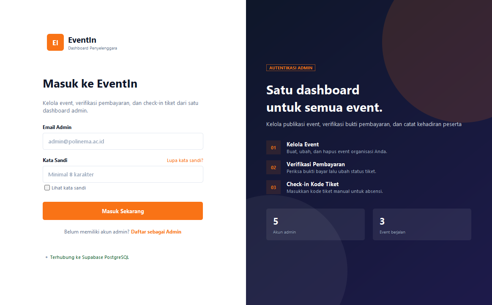 | 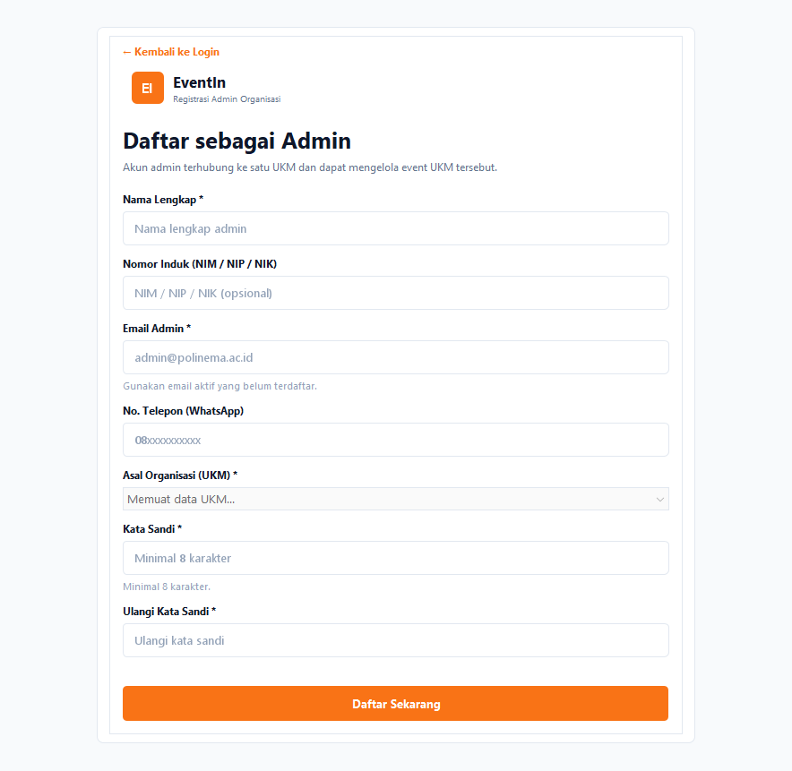 |

| Dashboard | Event Saya |
| --- | --- |
| 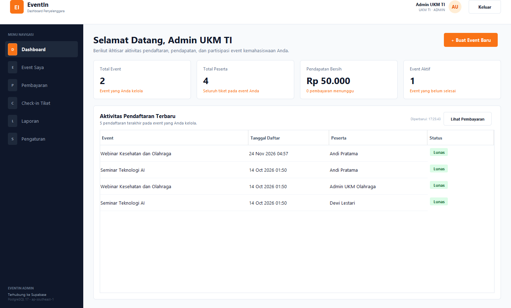 | 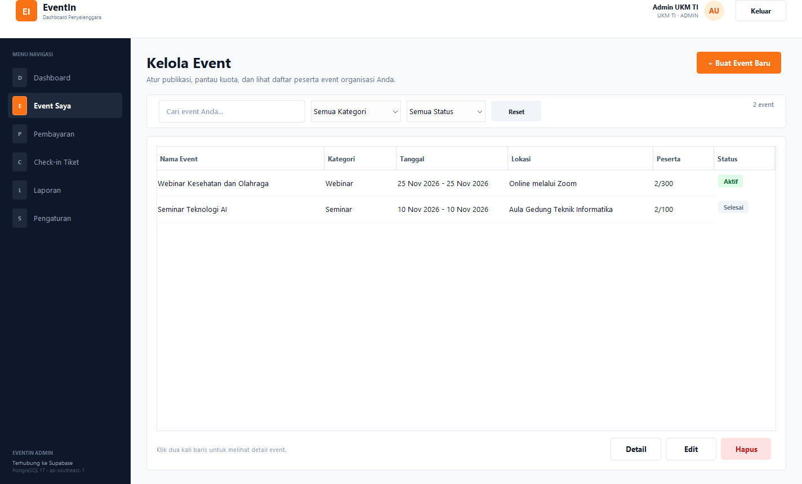 |

| Form Event | Detail Event |
| --- | --- |
| 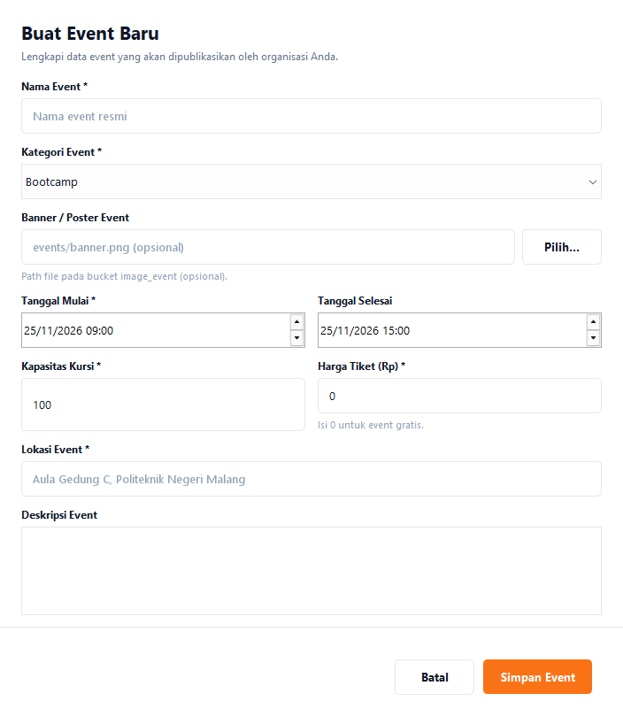 | 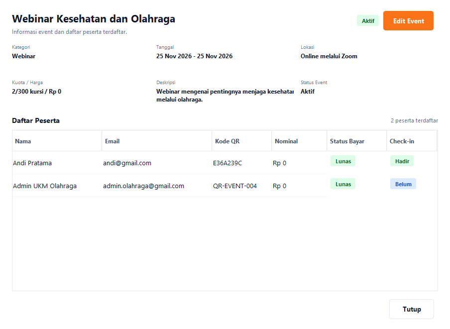 |

| Pembayaran | Verifikasi Pembayaran |
| --- | --- |
| 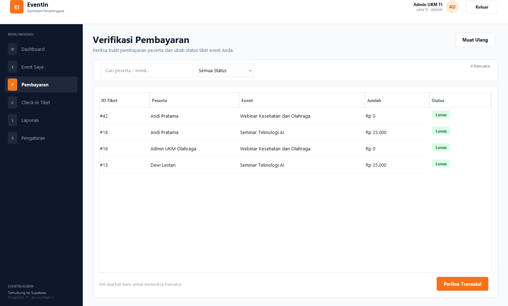 | 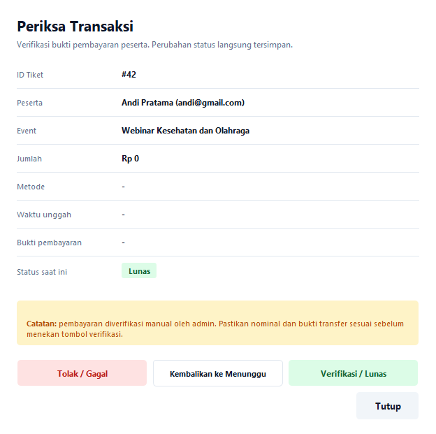 |

| Check-in Tiket | Laporan |
| --- | --- |
| 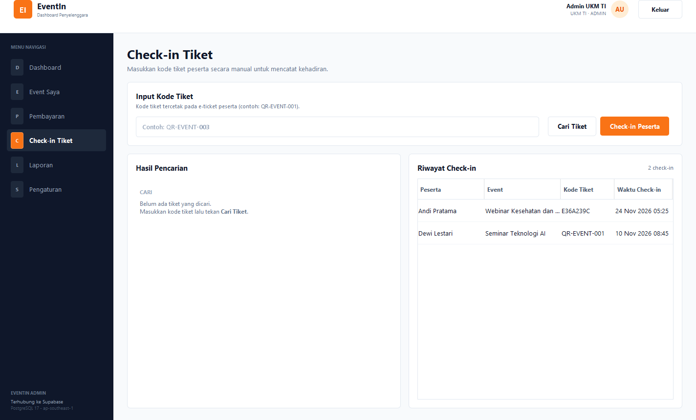 | 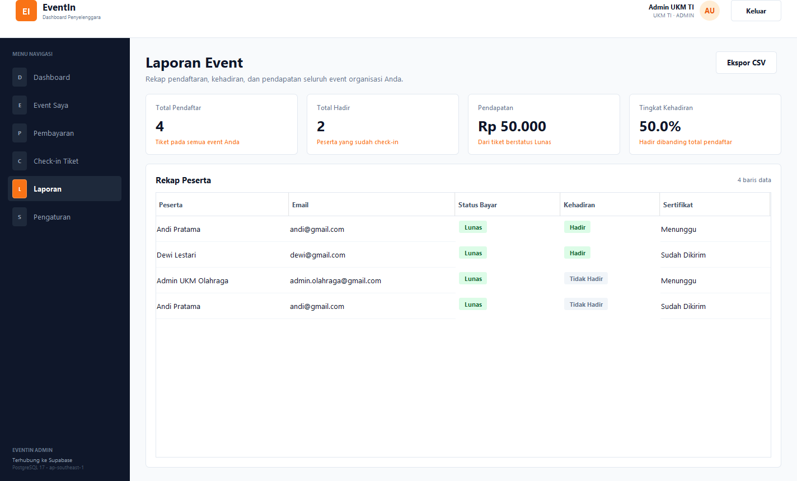 |

| Pengaturan Profil |
| --- |
| 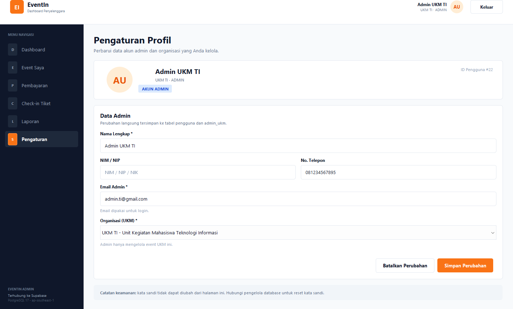 |